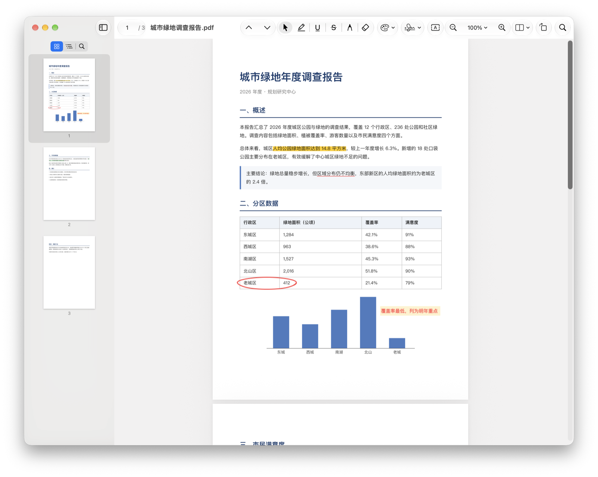
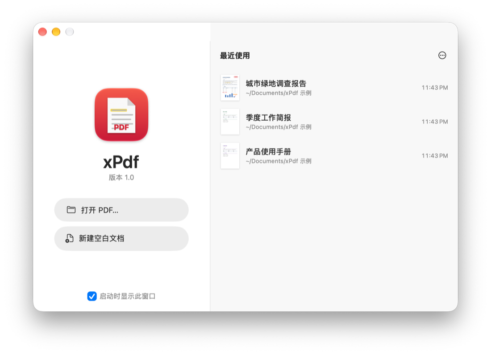
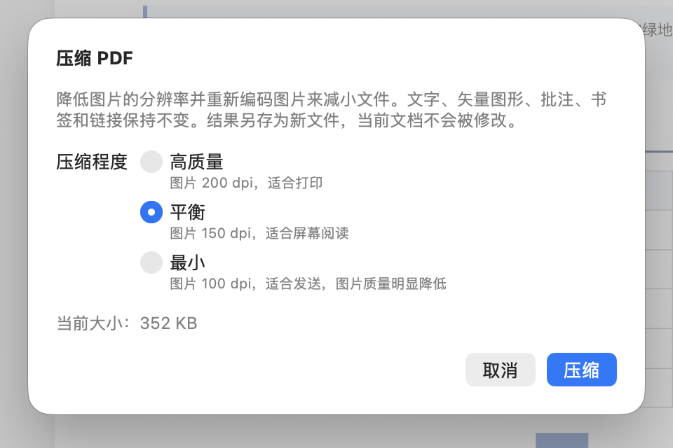
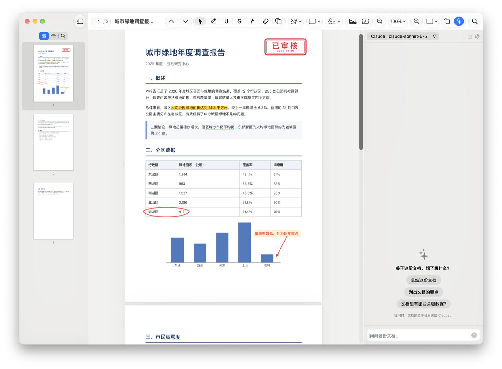

# xPdf

基于 SwiftUI + PDFKit 的原生 macOS PDF 阅读与编辑工具。



## 功能

**欢迎页**
- 启动时显示欢迎窗口：打开 PDF、新建空白文档，列出最近使用的文档（缩略图、位置、上次打开时间），可搜索、清除，也可以把 PDF 拖进来打开
- 可在窗口底部关闭"启动时显示"，随时通过"窗口 → 欢迎使用 xPdf"（⇧⌘1）打开



**阅读**
- 侧边栏：页面缩略图、文档目录（书签）、搜索结果
- 全文搜索，结果列表高亮关键词，点击跳转
- 缩放（适合窗口 / 实际大小 / 预设比例）
- 单页、单页连续、双页、双页连续四种显示方式
- 打开加密 PDF（输入密码解锁）、打印

**页面编辑**
- 旋转、删除页面，支持多选
- 在缩略图中拖动调整页面顺序
- 插入其他 PDF 或图片（可用于合并文件），也可直接把文件拖进窗口
- 插入空白页
- 将所选页面导出为新的 PDF 或 PNG 图片

**批注**
- 高亮、下划线、删除线：选中工具后划选文字即自动添加，可选颜色
- 文字批注
- 插入图片：工具栏图片按钮、"批注 → 插入图片…"（⌥⌘I）或直接 ⌘V 粘贴，支持透明 PNG，可拖动、拖右下角等比缩放；保存为标准图章批注，其他阅读器同样可见
- 形状：矩形、椭圆、直线、箭头，按住 Shift 画正方形、圆或 45° 线；矩形和椭圆可自由调整大小
- 白色遮盖：盖住页面上不需要的内容，可再在上面添加文字批注。**只是视觉遮挡**，被盖住的内容仍在文件中，不能用来隐藏敏感信息
- 画笔手绘，可调颜色与粗细；橡皮擦点击或拖过即可删除批注
- 手写签名：一次书写、保存后重复使用，点击页面放置
- 手绘与签名可拖动移动，拖右下角等比缩放
- 右键菜单可删除批注或对选中文字添加标记
- 放大后批注仍然清晰（修正了 PDFView 批注图层不随缩放重绘、放大后发虚的问题）

**文字识别（OCR）**
- 识别扫描件和图片中的中文、英文、日文、韩文，基于系统 Vision 框架，完全离线
- 在页面中加入隐藏文字层，识别后可搜索、选择、拷贝，页面外观不变
- 可选当前页、所选页面或全部页面；已有文字的页面自动跳过，被书签或链接指向的页面默认跳过（见已知限制）；显示进度，可中途停止
- 打开扫描件时提示条一键开始识别；整次识别可撤销

**压缩 PDF**
- 三档压缩：高质量（200 dpi）、平衡（150 dpi）、最小（100 dpi），通过降低图片分辨率和 JPEG 重新编码减小文件
- 逐页校验：只有文字、批注都完全保留且确实变小的页面才会被替换，其余页面保持原样；扫描件通常可减小 85% 以上
- 结果另存为新文件，当前文档不变；加密文档暂不支持



**AI 助手**
- 文档窗口右侧的对话面板（⌥⌘A 或工具栏 ✦ 按钮），针对当前文档提问：总结、列要点、查数据、解释内容
- 支持 Claude、OpenAI、DeepSeek，在"设置"（⌘,）中分别填写 API Key，模型列表从各服务商自动获取
- 回答流式显示；回答中的"第 N 页"可点击跳转；在文档中选中文字后提问会自动引用这段文字
- API Key 保存在系统钥匙串；提问时文档文字会发送给所选服务商，费用按其价格计算。扫描件需先 OCR



**表单**
- 直接填写 PDF 中的文本框、复选框、单选框和下拉框，Tab 键切换字段
- 打开带表单的文档时显示提示条，可一键清除表单内容
- 填写内容支持撤销，并随文档一起保存

所有编辑都支持撤销 / 重做，并直接保存回 PDF 文件。插入、删除、移动页面后，PDFKit 保存时会重新绘制每一页，浏览器导出的 PDF（Type 3 字体）文字会因此变成图形；xPdf 保存时会把每一页的原始内容放回去，文字保持可搜索、可拷贝。手绘和签名以标准 Ink 批注（矢量）写入，在其他 PDF 阅读器中同样可见。

## 快捷键

| 操作 | 快捷键 |
| --- | --- |
| 放大 / 缩小 / 实际大小 / 适合窗口 | ⌘= / ⌘- / ⌘0 / ⌘9 |
| 上一页 / 下一页 | ⌥⌘↑ / ⌥⌘↓ |
| 向左 / 向右旋转页面 | ⌘L / ⌘R |
| 删除所选页面 | ⌘⌫ |
| 插入文件中的页面 / 插入空白页 | ⇧⌘I / ⇧⌘B |
| 切换批注工具（选择、高亮、下划线、删除线、画笔、橡皮擦、形状） | ⌃⌘1 – ⌃⌘7 |
| 添加文字批注 | ⌥⌘T |
| 插入图片 / 粘贴图片 | ⌥⌘I / ⌘V |
| 新建签名 | ⌥⌘S |
| 识别文字（OCR） | ⇧⌘O |
| 压缩 PDF | ⌃⌘S |
| 显示 / 隐藏 AI 助手 | ⌥⌘A |
| AI 设置 | ⌘, |
| 欢迎窗口 | ⇧⌘1 |
| 取消放置签名 | Esc |
| 打印 | ⌘P |

## 构建

**环境要求**
- macOS 15 或更高版本
- Xcode 16 或更高版本
- [XcodeGen](https://github.com/yonaskolb/XcodeGen)（仅在修改工程配置或增删文件时需要）

**使用 Xcode**

```sh
git clone git@github.com:xinghelee/xPdf.git
cd xPdf
open xPdf.xcodeproj
```

然后在 Xcode 中按 ⌘R 运行。

**命令行**

```sh
xcodebuild -project xPdf.xcodeproj -scheme xPdf -configuration Release -derivedDataPath build build
open build/Build/Products/Release/xPdf.app
```

**重新生成工程**

`xPdf.xcodeproj` 由 `project.yml` 生成。新增、删除源文件或修改构建设置后，运行：

```sh
brew install xcodegen   # 首次
xcodegen generate
```

默认使用本地临时签名（Sign to Run Locally），只能在本机运行。如需分发，请在 `project.yml` 中配置你的开发团队与签名证书。

## 项目结构

```
xPdf/
├── XPdfApp.swift      # 应用入口（DocumentGroup）
├── PDFFile.swift      # PDF 文档的读取与保存
├── ViewerModel.swift  # 核心逻辑：页面操作、批注、搜索、撤销
├── PDFKitView.swift   # PDFView 封装：划词标记、手绘、橡皮擦、签名放置、拖动/缩放、右键菜单
├── ContentView.swift  # 主界面与工具栏
├── SidebarView.swift  # 侧边栏：缩略图、目录、搜索结果
├── ImageStamp.swift   # 插入图片：生成以图片为外观的图章批注
├── Signature.swift    # 签名数据、本地存储与手写面板
├── OCR.swift          # 文字识别引擎：渲染、Vision 识别、生成带隐藏文字层的页面
├── OCRSheet.swift     # 文字识别面板与扫描件提示条
├── Compress.swift     # 压缩引擎：Quartz 滤镜压缩图片，逐页校验后组装结果
├── CompressSheet.swift # 压缩面板
├── PageReferences.swift # 找出被书签和链接指向的页面
├── PDFGraft.swift     # 页面增删、移动后保存时恢复每一页的原始内容
├── AIService.swift    # AI 服务：Claude / OpenAI / DeepSeek 接口、模型列表、钥匙串
├── AIChat.swift       # AI 对话会话、侧边面板与设置界面
├── Welcome.swift      # 欢迎窗口与最近使用的文档
└── Commands.swift     # 菜单栏命令与快捷键
```

签名保存在应用沙盒内的 `~/Library/Containers/com.xinghelee.xPdf/Data/Library/Application Support/xPdf/signatures.json`。

## 已知限制

- 签名面板仅支持手写；已有签名图片可以用"插入图片"放到页面上
- 不支持直接修改 PDF 中原有的文字，可以用白色遮盖盖住原文，再添加文字批注
- 直线和箭头只能移动，不能拖动调整长度
- 没有真正的"涂黑删除"（redaction）：白色遮盖不会从文件中移除下面的文字和图片
- 用临时签名（ad-hoc）构建时，每次重新安装后系统会清空"最近使用的文档"
- 不支持创建新的表单字段，只能填写已有字段
- OCR 和压缩都需要用重建的页面替换原页面，而 PDFKit 保存时无法更新指向被替换页面的书签和链接（也无法保存在代码中修改的跳转目标），这些书签和链接会失效。因此被书签或链接指向的页面压缩时保持原样，OCR 时默认跳过（可手动选择仍然识别）
- 压缩依赖系统 Quartz 滤镜，它会重新嵌入字体，对许多原生文档（例如浏览器或办公软件导出的 PDF、使用苹方字体的中文文档）会损坏文字，这些页面会被检测出来并保持原样，因此这类文档通常压缩不了多少
- 系统 PDFKit 会对显示过的扫描页自动做一次识别（质量较低，中文字之间会带空格），保存时这层文字也会写入文件，且没有公开接口可以关闭。xPdf 的 OCR 不受影响：判断页面是否已有文字、生成文字层时都使用未经 PDFKit 处理的原始页面

## 许可证

[MIT](LICENSE)
